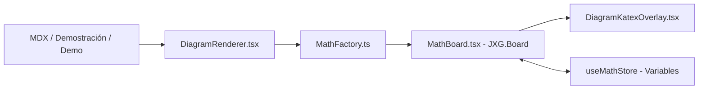

# Motor de diagramas interactivos (JSXGraph & DiagramSpec v3)

> **TL;DR**:
> - **Resumen**: Motor de diagramas reactivos 2D basado en la especificación declarativa DiagramSpec v3, adaptadores JSXGraph y capas KaTeX.
> - **Alcance**: Arquitectura modular en `src/diagrams/{model,geometry,jsxgraph,render}`, punto de entrada público `@/diagrams/public` y reactividad con `MathStore`.
> - **Archivos clave**: [`src/diagrams/public.ts`](../../src/diagrams/public.ts), [`src/diagrams/render/DiagramRenderer.tsx`](../../src/diagrams/render/DiagramRenderer.tsx), [`src/diagrams/jsxgraph/MathBoard.tsx`](../../src/diagrams/jsxgraph/MathBoard.tsx).

---

## Cómo se organiza el motor

El código del motor de diagramas reside en [`src/diagrams/`](../../src/diagrams/). Se encarga de renderizar representaciones geométricas y analíticas 2D interactivas, tanto dentro de los artículos MDX como en el panel lateral Marginalia y en el banco de pruebas del editor.

```
src/diagrams/
├── model/        # Esquemas Zod (DiagramSpec v3), primitivas, queries de objetos, expresiones, semántica y localización
├── geometry/     # Matemáticas de escena puras (coordenadas, áreas, curvas, solvers y layout/viewport)
├── jsxgraph/     # Adaptadores de bajo nivel para JSXGraph (MathBoard.tsx, MathFactory.ts, theme.ts)
├── render/       # Renderizado React (DiagramRenderer.tsx), hooks de ciclo de vida y capa KaTeX (DiagramKatexOverlay.tsx)
└── public.ts     # Contrato público unificado para el navegador (@/diagrams/public)
```

---

## Punto de entrada público y límites arquitectónicos

- **Para demos y componentes en el navegador**:
  ```ts
  import { createDiagramSpec, DiagramRenderer } from '@/diagrams/public';
  ```
- **Para entornos Node / parsing en el editor (sin React)**:
  ```ts
  import { … } from '@/diagrams';
  import { … } from '@/diagrams/model';
  ```
- **Límites de dependencia internos**:
  - `model/` y `geometry/` son matemáticamente puros: **nunca** importan de `jsxgraph/` ni de `render/`.
  - `render/` orquesta la vista y puede importar de `model/`, `geometry/` y `jsxgraph/`.
  - **Encapsulación estricta**: Ningún componente fuera de `src/diagrams/jsxgraph/` puede importar la biblioteca `jsxgraph` directamente.

---

## Flujo de renderizado de un diagrama



### 1. Definición de la escena (`model/` - DiagramSpec v3)
Cada diagrama se describe con una estructura declarativa y tipada (validada mediante esquemas Zod en `src/diagrams/model/schema/`) que define el tamaño del lienzo, coordenadas, bounding box y los elementos presentes (puntos, rectas, segmentos, polígonos, curvas, ángulos, transformaciones).

### 2. Gestión del tablero (`MathBoard.tsx`)
Encapsula la creación del lienzo de JSXGraph (`JXG.JSXGraph.initBoard`):
- Redimensiona el tablero cuando cambia el tamaño del contenedor (`ResizeObserver`).
- Gestiona eventos de ratón y gestos táctiles para arrastrar elementos.
- Destruye la instancia del tablero al desmontar el componente para evitar fugas de memoria.

### 3. Creación de elementos (`MathFactory.ts`)
Aplica los estilos del sistema de diseño ("Arts and Crafts": terracota, carbón, trazos opacos) al instanciar puntos, líneas, polígonos o funciones en JSXGraph.

---

## Capa de fórmulas con KaTeX (`DiagramKatexOverlay.tsx`)

Los textos por defecto en los canvas de HTML5 o SVG no tienen la calidad tipográfica requerida para fórmulas matemáticas formales:

- Matematika coloca una capa HTML transparente y reactiva sobre el tablero.
- Cada etiqueta matemática se renderiza con **KaTeX**.
- Al interactuar con el diagrama o mover un objeto, la capa calcula las coordenadas relativas en pantalla y desplaza la fórmula en tiempo real junto al elemento.

---

## Reactividad entre controles MDX y el diagrama (`MathStore`)

Los componentes MDX (como un deslizador o un botón de opción) se comunican con los diagramas a través de **`useMathStore`** ([`src/lib/page-context/MathStore.ts`](../../src/lib/page-context/MathStore.ts)):

1. Cada página MDX envuelve su contenido en un `<MathProvider>`.
2. Si un usuario mueve un deslizador `<Slider varName="radio" min={1} max={10} />`, este ejecuta `setVariable("radio", valor)`.
3. `DiagramRenderer` escucha los cambios en `radio` y actualiza la posición o forma de los objetos en el tablero sin necesidad de volver a renderizar todo el árbol DOM de React.

---

## Dónde están los diagramas publicados

Los diagramas que usan los autores en sus artículos están en [`content/diagrams/`](../../content/diagrams/) y se importan en MDX con la sintaxis `@content/diagrams/...`.

- `npm run diagram-usages:check`: Revisa que ningún artículo importe un diagrama inexistente o mal formado.
- `npm run editor:diagrams:check`: Verifica el soporte y compatibilidad de especificaciones en el editor.
