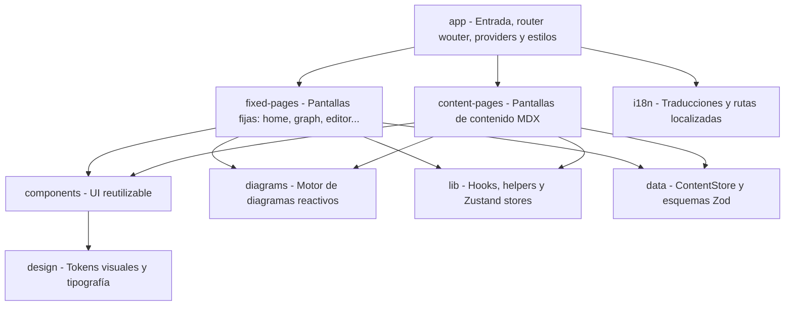

# Arquitectura del código en `src/` (Estructura Modular por Capas)

> **TL;DR**:
> - **Resumen**: Organización del código en `src/` mediante capas modulares estrictas, aislamiento entre pantallas fijas y de contenido, y desacoplamiento de estado.
> - **Alcance**: Las 9 capas reales del frontend (`app/`, `design/`, `components/`, `lib/`, `data/`, `diagrams/`, `fixed-pages/`, `content-pages/`, `i18n/`), enrutamiento Wouter y Zustand stores.
> - **Archivos clave**: [`src/app/App.tsx`](../../src/app/App.tsx), [`src/app/routes/AppRouter.tsx`](../../src/app/routes/AppRouter.tsx), [`docs/architecture/map.md`](map.md).

---

## Organización por capas

El código fuente dentro de `src/` organiza sus responsabilidades en 9 capas bien definidas, estructuradas de mayor a menor nivel de abstracción:

### 1. `app/` (Inicialización y configuración global)
Punto de arranque de la aplicación y configuración de dependencias globales:
- `main.tsx`: Punto de entrada de React 19 en el DOM.
- `App.tsx`: Layout principal y contenedores de contextos/proveedores.
- `routes/AppRouter.tsx`: Configuración de rutas declarativas con `wouter`.
- `styles/`: Estilos globales CSS (`index.css`, `theme.css`).

### 2. `design/` (Sistema de diseño)
Constantes visuales del tema ("Arts and Crafts"), tipografía, tokens y macros/estilos de KaTeX.

### 3. `components/` (Componentes UI reutilizables)
Componentes visuales puros y bloques reutilizables de UI (botones, modales, diálogo de confirmación, badges) que no constituyen pantallas completas.

### 4. `lib/` (Lógica transversal, utilidades y stores)
Hooks reutilizables, utilidades auxiliares y stores genéricos de Zustand (`MathStore`, `GlossaryStore`, `NavigationStore`, `UserProgressStore`).

### 5. `data/` (Modelos y fuentes de datos)
- `ContentStore`: Acceso y consulta al corpus indexado de contenido ([`src/data/content/ContentStore.ts`](../../src/data/content/ContentStore.ts)).
- `schemas.ts`: Validación y esquemas de metadatos con Zod ([`src/data/content/schemas.ts`](../../src/data/content/schemas.ts)).
- `graph/`: Estructura del grafo calculada (`graph_structure.json`).

### 6. `diagrams/` (Motor de diagramas interactivos)
Motor de especificación, cálculo geométrico y renderizado de diagramas (JSXGraph y KaTeX).
- Submódulos: `model/`, `geometry/`, `jsxgraph/`, `render/`.
- Entrada pública: `@/diagrams/public` ([`src/diagrams/public.ts`](../../src/diagrams/public.ts)).

### 7. `fixed-pages/` (Pantallas fijas de producto)
Pantallas de la aplicación con estructura fija e interactividad propia:
- `home/`: Portada y navegación principal.
- `graph/`: Visor interactivo del grafo lógico ([`GraphPage.tsx`](../../src/fixed-pages/graph/GraphPage.tsx)).
- `glossary/`: Diccionario de conceptos y glosario.
- `mathematicians/`: Línea temporal de matemáticos y biografías.
- `editor/`: Editor híbrido (Monaco + WYSIWYG) con sesión, guardado y banco de pruebas de diagramas.

### 8. `content-pages/` (Pantallas para tipos de contenido MDX)
Plantillas que renderizan los distintos tipos de artículos matemáticos definidos en MDX (`screens/` para teoremas, definiciones, axiomas, ejemplos, ejercicios, demostraciones, planes de estudio).

### 9. `i18n/` (Internacionalización)
Diccionarios de traducción (castellano `es`, euskera `eu`), utilidades de localización y enrutamiento traducido.

---

## Reglas de aislamiento e inviolabilidad

1. **Aislamiento entre pantallas**: `fixed-pages/` y `content-pages/` **no** se importan entre sí.
2. **Motor frente a contenido**: `src/diagrams/` contiene estrictamente el **motor**. Los diagramas publicados y módulos interactivos creados por autores residen en `content/diagrams/`.
3. **Encapsulación de JSXGraph**: La librería `jsxgraph` solo se importa directamente dentro de `src/diagrams/jsxgraph/`. Ningún otro módulo de la aplicación debe importarla directamente.

---

## Enrutamiento con `wouter`

El enrutador [`src/app/routes/AppRouter.tsx`](../../src/app/routes/AppRouter.tsx) gestiona las URLs mediante tres despachadores:

1. **Rutas de 3 segmentos (`/:lang/:segment/:id`)**:
   Mapea URLs traducidas (como `/es/teorema/pitagoras` o `/eu/teorema/pitagoras`) usando `SEGMENT_TO_CANONICAL_TYPE` para cargar la pantalla correspondiente de `content-pages`.
2. **Rutas de 2 segmentos (`/:first/:second`)**:
   Maneja vistas fijas traducidas (como `/:lang/diccionario` o `/:lang/grafo`).
3. **Rutas de 1 segmento (`/:segment`)**:
   Resuelve `/es` o `/eu` hacia la portada local (`fixed-pages/home`).

---

## Stores de Zustand en la aplicación

| Store | Archivo | Para qué sirve |
|---|---|---|
| `useMetadataStore` | [`src/data/metadata/MetadataStore.ts`](../../src/data/metadata/MetadataStore.ts) | Guarda los metadatos de la página activa (título, autor, TOC, dependencias). |
| `useGraphStore` | [`src/fixed-pages/graph/GraphStore.ts`](../../src/fixed-pages/graph/GraphStore.ts) | Estado del lienzo del grafo, axiomas activos y modelo seleccionado. |
| `useMathStore` | [`src/lib/page-context/MathStore.ts`](../../src/lib/page-context/MathStore.ts) | Store reactivo por página para sincronizar variables numéricas con diagramas. |
| `useGlossaryStore` | [`src/lib/stores/GlossaryStore.ts`](../../src/lib/stores/GlossaryStore.ts) | Términos abiertos en el panel Marginalia y modo de presentación. |
| `useNavigationStore` | [`src/lib/stores/NavigationStore.ts`](../../src/lib/stores/NavigationStore.ts) | Estado de apertura del buscador omnibar (`Cmd+K`). |
| `useProgressStore` | [`src/lib/stores/UserProgressStore.ts`](../../src/lib/stores/UserProgressStore.ts) | Artículos leídos y ejercicios completados (almacenamiento en `localStorage`). |

---

## Paleta de colores y estilo visual

El tema visual ("Arts and Crafts") busca una estética clara y cómoda para lectura prolongada:
- **Lienzo** (`#fafaf9`): Fondo principal en tono papel.
- **Carbón** (`#1c1917`): Tipografía y elementos nítidos.
- **Canela / Terracota**: Tonos de acento para destacar teoremas y definiciones.
- **KaTeX**: Tipografía matemática estándar integrada en la jerarquía tipográfica.
